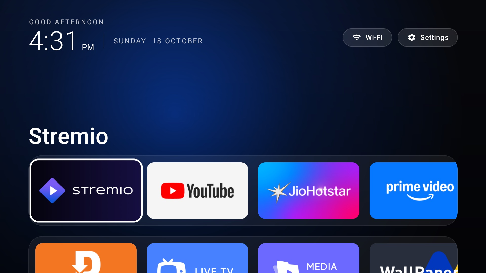

# Android TV: Debloat + Custom Launcher

Remove the bloatware and ads from an Android TV, and replace the stock home screen with a clean, Apple TV-style launcher. No root, no USB cable, and everything is reversible.

Written up end to end here: [How I Debloated My Android TV and Built My Own Launcher With Claude Code](https://princejain.me/blogs/debloat-android-tv-custom-launcher-claude-code).



## What's inside

```text
debloat/
  debloat.sh            hide every app in a list (reversible)
  restore.sh            bring one app, or all of them, back
  packages.txt          your removal list (empty template)
  examples/xiaomi-tv.txt  the 32 packages removed from a Xiaomi OLED TV
launcher/               the custom home screen (Kotlin + Jetpack Compose for TV)
```

**The launcher** shows a clock, greeting and date, Wi-Fi and Settings buttons, a favourites row and an all-apps row. The background glows in the brand colour of the selected app. Pressing Home always returns to the first favourite, Back does nothing on the home screen, and long-pressing a tile opens App info. It also keeps "Ok Google" working after the stock launcher is disabled (see [Gotchas](#gotchas)).

## What you need

- An Android TV or Google TV (a TV with Android built in, or a streaming box). Built and tested on Android TV 9 and 11.
- A laptop on the same Wi-Fi.
- [ADB](https://developer.android.com/tools/adb) (`brew install --cask android-platform-tools` on a Mac).
- For the launcher only: [Android Studio](https://developer.android.com/studio) (free), which provides the JDK and Android SDK. You never have to open it.
- Optional but recommended: a coding agent such as [Claude Code](https://docs.claude.com/en/docs/claude-code/overview) to do all of this for you.

## The easy way: let a coding agent do it

Open your coding agent in this folder and paste:

```text
I want to debloat my Android TV and install the custom launcher in this repo. This is a TV I own.
Developer mode and USB debugging are on. TV IP: <your TV's IP>. Same Wi-Fi as this laptop.
Apps I use: <e.g. Netflix, Prime Video, YouTube>.

Read README.md and CLAUDE.md first. Connect over ADB, list every installed app grouped by category,
and mark what's bloat, what's safe to keep and what must never be removed. Ask me before removing
anything. Then set my favourites in the launcher, build it, install it and make it the home screen.
```

## The manual way

### 1. Turn on developer mode (on the TV)

1. **Settings → Device Preferences → About**, click **Build** seven times.
2. **Developer options** → turn on **USB debugging** (on most Android TVs this also enables network debugging).
3. Note the TV's IP from **Settings → Network**.

```bash
adb connect <tv-ip>:5555
```

The first time, the TV asks **"Allow USB debugging?"** Tick **"Always allow from this computer"** and press Allow.

### 2. Debloat

See what's installed, then put the packages you want gone in `debloat/packages.txt` (one per line). If you have a Xiaomi TV, start from `debloat/examples/xiaomi-tv.txt`.

```bash
adb -s <tv-ip>:5555 shell pm list packages        # everything
adb -s <tv-ip>:5555 shell pm list packages -3     # apps you (or the manufacturer) installed

cd debloat
./debloat.sh <tv-ip>                              # uses packages.txt
./debloat.sh <tv-ip> examples/xiaomi-tv.txt       # or any list
```

Apps are removed with `pm uninstall -k --user 0`, which hides them from your user profile without deleting them from the system. **Never remove** Live TV, chip/vendor services (e.g. `com.mediatek.*`), the remote's Bluetooth service, TV settings, Play Services or the keyboard: doing so can break the remote, the inputs or booting.

### 3. Build and install the launcher

Set your favourites at the top of `launcher/app/src/main/java/me/prince/launcher/Apps.kt` (package names come from `pm list packages -3`; apps that aren't installed are skipped). Then:

```bash
cd launcher
export ANDROID_HOME=~/Library/Android/sdk          # or create local.properties with sdk.dir=...
./gradlew assembleRelease

S=<tv-ip>:5555
adb -s $S install -r app/build/outputs/apk/release/app-release.apk
adb -s $S shell pm grant me.prince.launcher android.permission.ACCESS_COARSE_LOCATION   # shows the Wi-Fi name
adb -s $S shell pm grant me.prince.launcher android.permission.RECORD_AUDIO             # keeps "Ok Google" working
adb -s $S shell cmd package compile -m speed -f me.prince.launcher                      # faster cold start
adb -s $S shell am start -n me.prince.launcher/.MainActivity                            # try it first
```

Always install the **release** build: it's optimised with R8, and debug Compose builds are noticeably slow on TV hardware.

### 4. Make it the home screen

Only once the launcher works:

```bash
adb -s $S shell cmd package set-home-activity me.prince.launcher/.MainActivity
adb -s $S shell input keyevent KEYCODE_HOME
```

If Home still opens the stock launcher, disable it (disabled, not uninstalled, so it can come back):

```bash
adb -s $S shell pm disable-user --user 0 com.google.android.tvlauncher
```

## Undo everything

```bash
cd debloat
./restore.sh <tv-ip> <package>   # bring one app back
./restore.sh <tv-ip>             # bring back everything in packages.txt and re-enable the stock launcher
adb -s <tv-ip>:5555 uninstall me.prince.launcher
```

If the TV ever shows a black screen on Home, `adb -s <tv-ip>:5555 shell pm enable com.google.android.tvlauncher` brings the stock launcher back.

## Gotchas

- **The stock launcher wins Home.** It's a system app with a higher priority than yours, so `set-home-activity` alone often doesn't stick. Disable it, but only after your launcher is installed and tested, or you get a black screen.
- **Disabling the stock launcher can kill "Ok Google".** Android 11+ only lets a background app use the microphone if an app in the foreground lends it that permission, and the stock launcher was doing that for Google Assistant. The launcher's `HotwordService` does the same job: it holds microphone permission (it never records anything) and shares it with the Assistant. If "Ok Google" had already given up before you installed the launcher, restart the Assistant once: `adb shell am force-stop com.google.android.katniss`.
- **The Wi-Fi button says "Wi-Fi" instead of your network name.** Android only reveals the network name to apps with location permission; run the `pm grant ... ACCESS_COARSE_LOCATION` line above.
- **VPN ad blockers.** Apps like AdGuard run as a VPN, which makes the VPN the "active network". The launcher checks every network, so the Wi-Fi label still works.
- **Firmware updates** can bring removed apps back. Re-run `./debloat.sh <tv-ip>`.

## Licence

[MIT](LICENSE)
